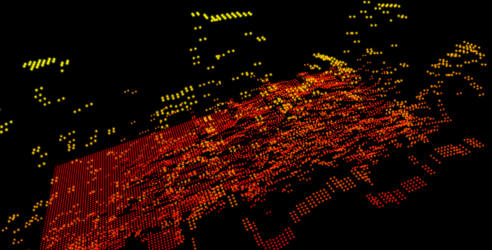

# Spectral Grid

A native Windows music visualizer that turns system audio into a scrolling landscape of glowing 3D particles. Built with C++20, Direct3D 11 and WASAPI loopback by **uberArius**.

[Download for Windows](https://github.com/uberArius/spectral-grid/releases/latest) · [Source code](https://github.com/uberArius/spectral-grid) · [Report a bug](https://github.com/uberArius/spectral-grid/issues)



## Features

- Capture your default Windows playback device: play music in your usual player or browser.
- Up to 256 frequency bands × 256 history columns, rendered as GPU-instanced particles.
- Particles launch from 70% of their target height, rise, fall under adjustable gravity and bounce once. Bounce defaults to 40% of the original height; zero disables it.
- Each particle keeps its launch color throughout its flight and bounce. Customize the palette, color midpoint, brightness and glow.
- Scroll at 10–240 columns per second in steps of 10, independently of frame rate.
- FFT sizes from 2,048 to 16,384 samples, with roughly 480 spectrum updates per second at common sample rates.
- Optional spectrum smoothing, compression, normalization, noise gate and frequency-dependent treble boost. Smoothing is off by default.
- Tilt, pan and zoom, or spin the grid in its own plane like a turntable. Automatic rotation ranges from stationary to one turn every five seconds.
- Windowed, borderless and fullscreen modes, transparent background and always-on-top support.
- VSync and frame limits up to 240 FPS, plus unlimited rendering.
- Local settings; no account, server or runtime network connection required.

## Download and run

1. Open the [latest release](https://github.com/uberArius/spectral-grid/releases/latest).
2. Download `SpectralGrid-1.0.0-Windows-x64.zip` and extract it.
3. Run `SpectralGrid.exe` and play audio through your default Windows output device.

Requires **Windows 10 or 11, x64**, and a hardware GPU supporting Direct3D feature level 11.0. No installer or Visual Studio installation is required. Keep bundled license files when redistributing the application.

Source is available through **Code → Download ZIP**, by cloning the repository, or as a source ZIP in the release. Release archives include SHA-256 checksums.

## Controls

| Control | Action |
| --- | --- |
| Left-drag horizontally | Spin around the grid center in its own plane |
| Left-drag vertically | Tilt |
| Right-drag | Pan |
| Mouse wheel | Zoom |
| F1 | Toggle settings |
| R | Reset camera |
| Esc | Hide settings |
| F11 | Toggle fullscreen |
| Alt + left-drag | Move a borderless window |
| Alt + right-drag | Resize a borderless window |

Move the mouse to reveal settings. The panel fades after inactivity. Settings are stored in `%LOCALAPPDATA%/SpectralGrid/settings.json`.

## Adjusting the visualization

Start with **Sensitivity** and **Height**. Gravity controls acceleration; **Bounce height** sets the rebound peak as a percentage of the original target. The color midpoint controls where the palette reaches its halfway color, based on the original target height rather than the changing position.

For less equalization across frequencies, leave compression, treble boost and normalization off. Larger FFTs improve bass resolution but increase the time window. Overlapping FFT windows share audio samples even with smoothing off; this is not mixing the heights of neighboring columns. More visual bands cannot create frequency detail absent from the FFT.

If the grid stays flat, check the default Windows output and noise gate. Protected audio or applications using a different output may not be captured. Actual frame rate depends on GPU load, VSync and display refresh rate. This release uses SDR rendering.

## Build from source

Install Visual Studio 2022 or Build Tools 2022 with **Desktop development with C++**, MSVC v143, a Windows SDK and **C++ CMake tools for Windows**. CMake 3.24 or newer is required.

```powershell
git clone https://github.com/uberArius/spectral-grid.git
cd spectral-grid
powershell -ExecutionPolicy Bypass -File ./build.ps1 -Package
```

The script builds Release x64, runs core tests, installs into `dist/SpectralGrid` and creates binary/source ZIPs in `dist`. Initial configuration downloads hash-pinned Dear ImGui and nlohmann/json dependencies from GitHub. Their code and the MSVC runtime are linked statically; shaders are embedded in the EXE.

Manual commands with CMake on PATH:

```powershell
cmake -S . -B build -G "Visual Studio 17 2022" -A x64
cmake --build build --config Release --parallel
ctest --test-dir build -C Release --output-on-failure
cmake --install build --config Release --prefix dist/SpectralGrid
cpack --config build/CPackConfig.cmake -C Release -B dist
```

Run `test-windows.ps1` on an interactive Windows desktop for GPU and window integration checks. GitHub Actions builds the app and runs core tests; hardware checks run locally. See [architecture](ARCHITECTURE.md), [validation](TEST_REPORT.md) and [contributing](CONTRIBUTING.md).

## License and attribution

Copyright 2026 uberArius. Licensed under [Apache License 2.0](LICENSE). You may use, clone, modify and redistribute the project, including commercially, subject to its terms. Retain required license and attribution notices, including the original project reference in [NOTICE](NOTICE), when distributing derived work. Apache 2.0 does not require a visible link in every application UI.

Original project: **https://github.com/uberArius/spectral-grid**

Dependencies retain their MIT licenses; see [third-party notices](THIRD_PARTY_NOTICES.md).
